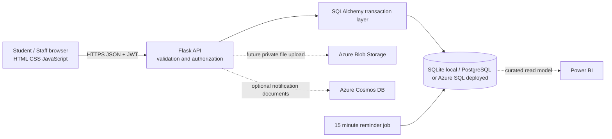

# Architecture

The browser never connects directly to the database. Identity is authenticated at the API; authorization is checked per route and for resource ownership. Relational DB is the system of record. The reminder worker writes deduplicated in-app notifications; the API exposes them to the user's inbox. Optional Azure services extend the design; local execution does not provision them.

## Deployment boundary
Local demo: browser and Flask on the developer machine, SQLite file. Docker: Flask and PostgreSQL containers on a private Compose network. Cloud target: TLS ingress, private app subnet, managed relational DB with private access, secret store, private Blob container, monitoring/audit sink and least-privilege managed identities. Disable public DB access; restrict ingress to app tier; use backups and key rotation.
