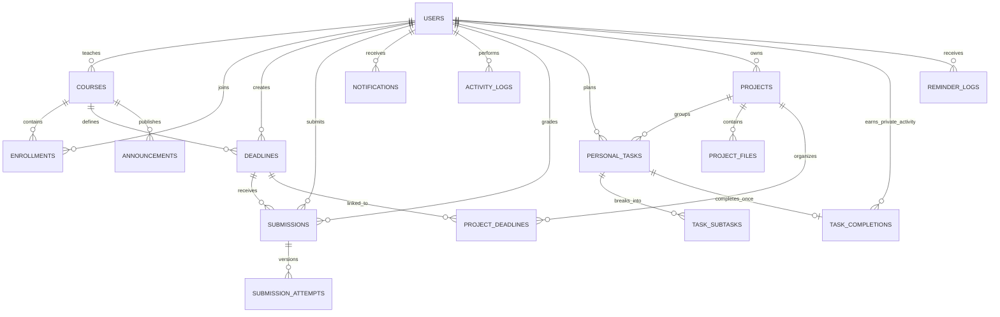

# Entity relationship model

The relational design separates accounts, coursework, planning workspaces and append-only history. `enrollments(user_id,course_id)`, current `submissions(deadline_id,user_id)`, submission attempt number and project-deadline links are constrained as unique keys. Project binaries stay outside the relational store; SQL retains opaque keys and metadata. Task completion has one event per task, preventing repeated toggles from inflating a streak. Course staff data is referenced, not copied into deadlines. See `database/schema.sql` for constraints and referential actions.
