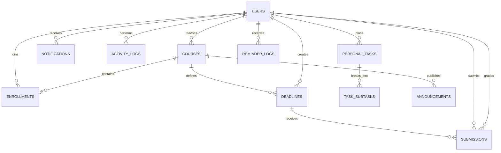

# Entity relationship model

Seven core tables use surrogate primary keys. `enrollments(user_id,course_id)` and `submissions(deadline_id,user_id)` are candidate keys enforced as unique constraints. Each table stores attributes about one entity or relationship. Course staff data is referenced, not copied into deadlines. The documented attributes avoid repeating groups and transitive dependencies, giving a practical 3NF example. See `database/schema.sql` for checks and referential actions.
